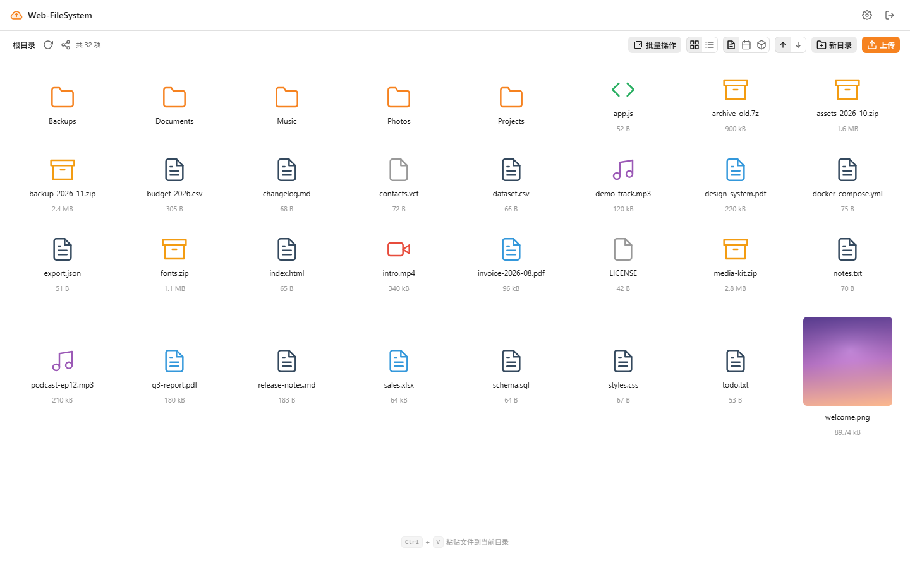
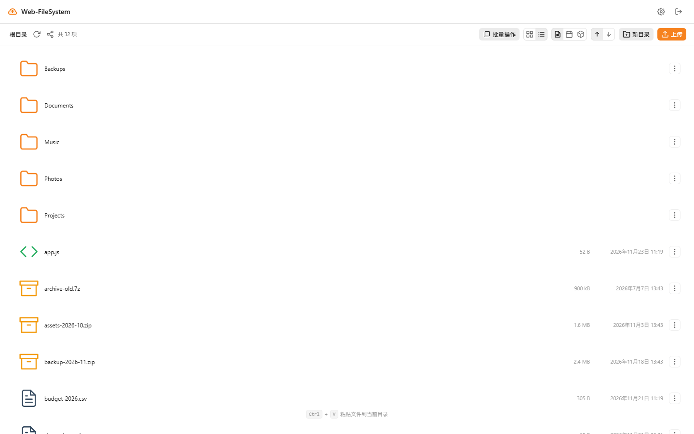
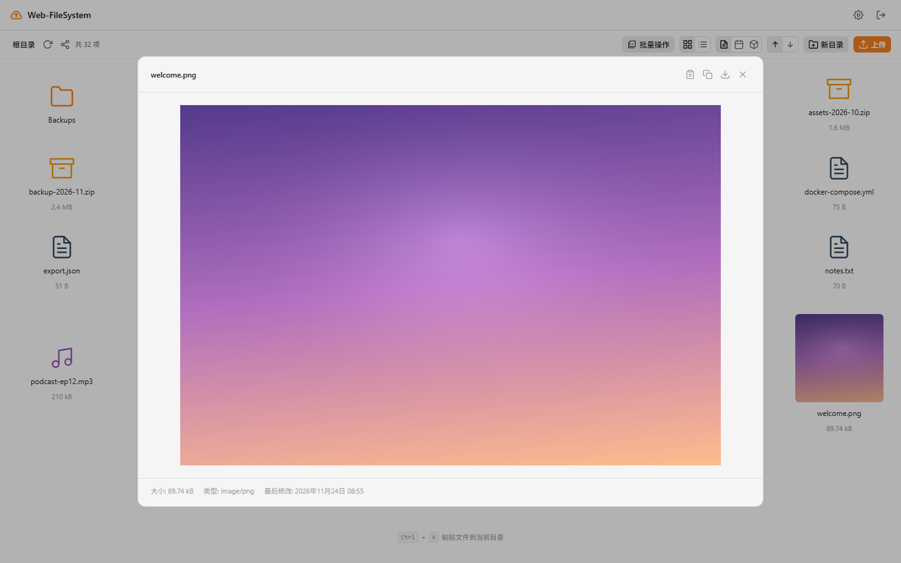
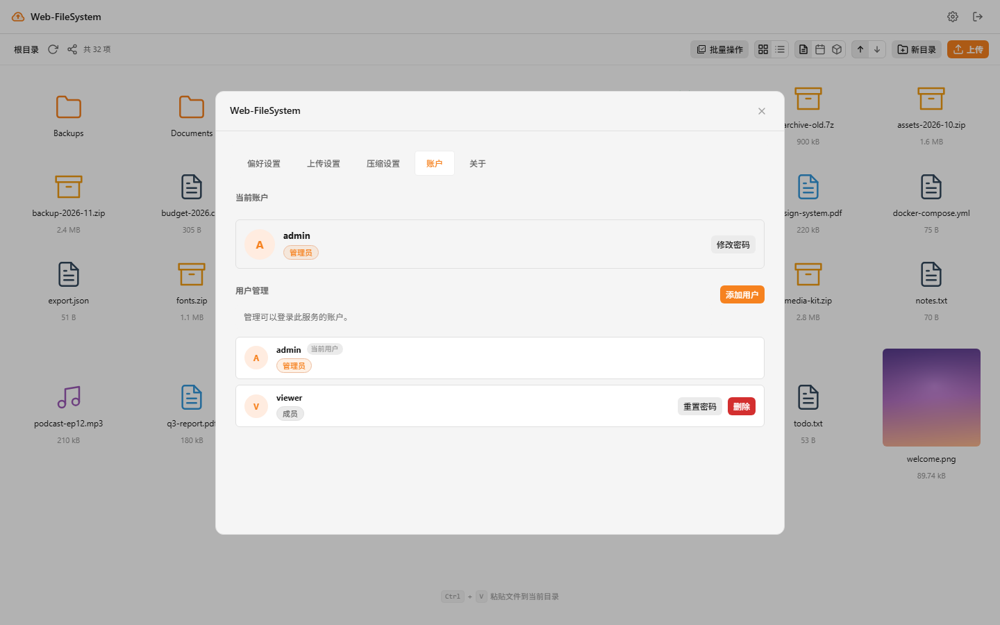
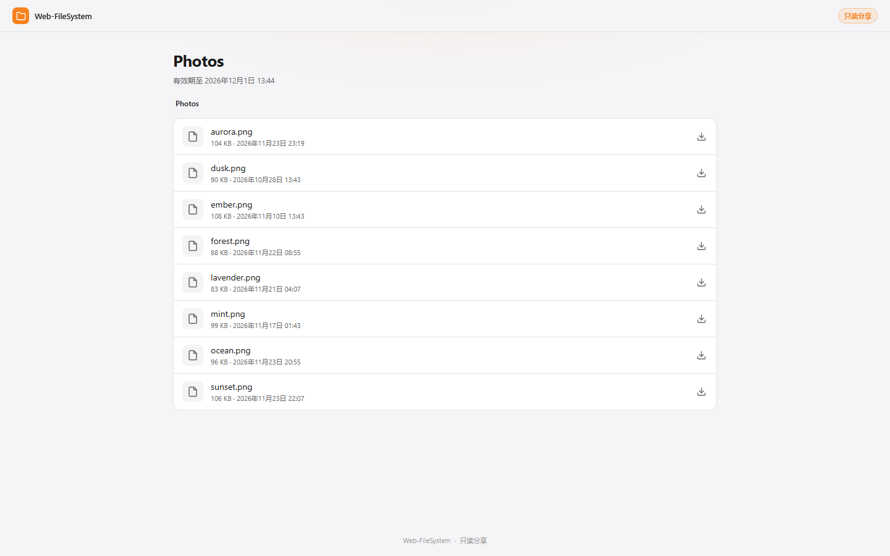
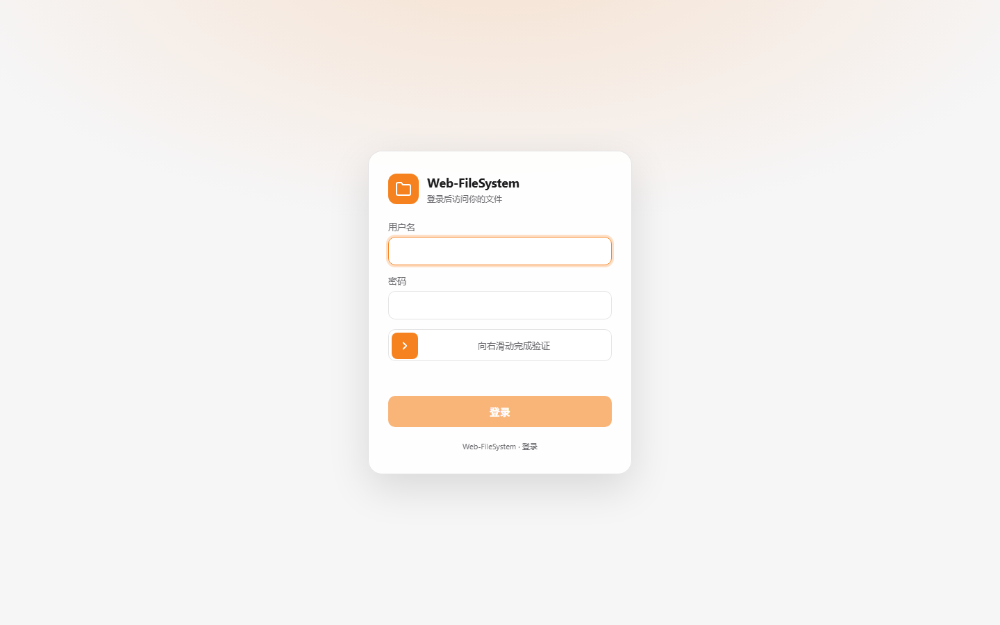

# Web-FileSystem

📁 本地优先的 Web 文件管理器，完全运行在你自己的电脑上。零依赖 Node.js 服务把本机文件夹当作存储，无需任何云服务或第三方账号。

**中文 | [English](./README.md)**

## 特性

| 能力             | 说明                                                                                 |
| ---------------- | ------------------------------------------------------------------------------------ |
| **本地文件服务** | 零依赖 Node.js 服务，把本机文件夹当作存储桶，无需任何云账号或外部服务
| **账户与认证**   | 内置登录页、滑动验证和 7 天会话；多用户、管理员/成员角色、修改密码；支持 `--no-auth` |
| **完整文件管理** | 目录浏览、名称/日期/大小排序、预览、重命名、复制、移动、递归删除、批量操作           |
| **上传体验**     | 拖拽/粘贴上传、并发上传、自动分片、暂停/继续、断点清理                               |
| **文件名模板**   | `[name]`、`[ext]`、`[hash:N]`、日期、时间戳、UUID 和目录模板                         |
| **图片压缩**     | JPEG、PNG、WebP、AVIF 本地 WebAssembly 压缩，可选 Tinify（经你自己的本地服务转发）      |
| **预览与分享**   | 图片、视频、音频、文本预览；直链、二维码、Markdown、HTML；免登录只读分享链接          |
| **跨平台体验**   | PWA、浅色/深色主题、zh / zh_TW / en / ja 多语言                                      |

## 界面截图



| 列表视图 | 图片预览 |
| --- | --- |
|  |  |

| 账户设置 | 只读分享页 |
| --- | --- |
|  |  |

| 登录 | 会话与权限 |
| --- | --- |
|  | 密码 + 滑动验证、7 天会话、管理员/成员角色。 |

## 快速开始

需要 Node.js 18+。项目没有第三方运行时依赖，无需安装即可启动：

```bash
npm run dev
# 打开 http://127.0.0.1:5500
```

首次启动时，服务会生成一个随机登录密码并只显示一次：

```text
  Web-FileSystem (local mode)
  ➜  http://127.0.0.1:5500
  ➜  data: /path/to/web-filesystem/data
  ➜  bucket: local
  ➜  auth: user "admin" / password "xxxxxxxxxxxx" (generated, shown only once)
```

请保存该密码。密码哈希保存在 `data/.web-filesystem/auth.json`；之后启动会继续使用同一密码。

### 自定义登录账号

```bash
# 指定用户名和密码（会写入 auth.json，后续启动继续生效）
npm run dev -- --auth-user admin --auth-password 'your-password'

# 关闭登录认证（仅建议在本机回环地址使用）
npm run dev -- --no-auth

# LAN运行
node server.js --host 0.0.0.0 --port 5500
```

也可以使用环境变量：`AUTH_USER`、`AUTH_PASSWORD`、`NO_AUTH=1`、`TRUST_PROXY=1`。

### Docker 部署

```bash
cd docker
cp .env.example .env          # 可选：设置端口、登录账号与密码
docker compose up -d --build
```

打开 `http://localhost:5500`。数据保存在命名卷 `web-filesystem-data`，重启容器不会丢失。若未在 `.env` 中设置 `AUTH_PASSWORD`，首次启动会在 `docker compose logs app` 中打印一次随机密码。备份、改用宿主机目录及安全说明见 [docker/README.md](./docker/README.md)。

### 命令行参数

| 参数              | 环境变量        | 默认值      | 说明                             |
| ----------------- | --------------- | ----------- | -------------------------------- |
| `--port`          | `PORT`          | `5500`      | 监听端口                         |
| `--host`          | `HOST`          | `127.0.0.1` | 监听地址；局域网访问用 `0.0.0.0` |
| `--data`          | `DATA_DIR`      | `./data`    | 数据目录                         |
| `--bucket`        | `BUCKET`        | `local`     | 本地桶名称                       |
| `--auth-user`     | `AUTH_USER`     | `admin`     | 登录用户名                       |
| `--auth-password` | `AUTH_PASSWORD` | 自动生成    | 登录密码                         |
| `--no-auth`       | `NO_AUTH=1`     | —           | 完全关闭登录认证                 |
| `--trust-proxy`   | `TRUST_PROXY=1` | —           | 信任 `X-Forwarded-For` 用于登录限流（仅限可信反代后开启） |

### 用户管理

- 首次启动会创建一个管理员账户（默认用户名 `admin`），之后可在 **设置 → 账户** 中修改自己的密码。
- 管理员还可以添加用户、设置管理员/成员角色、重置其他用户的密码或删除用户；成员只能修改自己的密码。
- 新密码至少 8 个字符。重置密码或删除用户会让该用户已有的登录会话立即失效；修改自己的密码会保留当前会话、注销其他会话。
- 用户信息与密码哈希保存在 `data/.web-filesystem/auth.json`。旧版单用户记录会自动迁移为管理员账户，原有登录密码继续有效。
- 启动时传入 `--auth-password` 会把目标账户（`--auth-user`，省略时取现有管理员）的密码设为新值并确保其为管理员，其他用户不会被删除。

### 登录验证

登录页在密码之外还要求完成一次向右滑动验证。服务端签发一次性挑战（5 分钟过期、最短等待时间），登录时必须携带已验证的挑战；验证失败或登录失败后需要重新滑动。该校验用于增加简单的自动化成本，**不是** TOTP 一类的密码学双因子认证。连续登录失败达到上限后仍会按 IP 限流。

挑战签发另有按 IP 的限流（5 分钟 30 次），与登录失败限流叠加。若服务部署在反向代理之后，请以 `--trust-proxy`（或 `TRUST_PROXY=1`）启动，让两处限流看到真实客户端地址而不是代理地址；仅在反代会覆盖 `X-Forwarded-For` 时开启。

### 数据目录

```text
data/
├── local/                     # 桶内容（即文件本体）
├── .web-filesystem/
│   ├── meta.json              # Content-Type 元数据
│   ├── auth.json              # 用户列表、角色与密码哈希（v2）
│   ├── share-secret           # 分享链接签名密钥（勿泄露）
│   └── tmp/                   # 上传暂存（启动时清空）
└── .uploads/                  # 分片上传临时目录（启动时清空）
```

### 存储行为

- 上传内容先写入 `data/.web-filesystem/tmp/`，再原子 `rename` 到目标位置：上传中的半成品不会出现在列表里，也无法被下载。
- 静态资源与对象都带 `ETag`；刷新与重复预览会重新验证，通常只产生 `304`。
- 删除目录只需一次请求（服务端递归删除）。
- 包含 `\`、`.`/`..` 段，或通过符号链接解析到桶外的 key 都会被拒绝。

> [!WARNING]
> `--host 0.0.0.0` 会把服务暴露到局域网。登录密码通过明文 HTTP 传输，请只在可信网络使用；跨网络访问建议放在 HTTPS 反向代理之后。不要把 `--no-auth` 与非回环地址一起使用。

## 常用配置

### 文件名模板

- `[name]_[hash:6].[ext]` — 原文件名 + 内容哈希
- `images/[date:YYYY/MM/DD]/[uuid].[ext]` — 按日期组织目录
- `backup/[timestamp]-[name].[ext]` — 时间戳备份文件名

### 只读分享链接

使用内置本地文件服务（`npm run dev`）时，可以对文件或目录生成**免登录的只读分享链接**；链接由服务端签名，接收者不需要登录也能访问。

- 在文件或目录的右键菜单中选择「分享链接」；目录也可以使用工具栏的分享按钮。
- 可选有效期：1 天、7 天、30 天、1 年或永久。过期后服务端会拒绝访问。
- 链接中的签名覆盖存储桶、路径和有效期，篡改任意一项都会失效；接收者无需账号或登录。
- 通过链接只能列出、预览和下载分享范围内的内容，不能上传、修改或删除。
- 目录分享以创建时的目录为根，包含其下所有子目录和文件（包括链接有效期内新增的文件）。请勿分享包含敏感内容的上级目录。

签名密钥保存在 `data/.web-filesystem/share-secret`。删除或轮换该文件会让**所有**已生成的分享链接立即失效（重启后自动生成新密钥）。目前没有针对单条链接的撤销界面；如需提前失效，请删除对应文件/目录、等待过期或轮换密钥。

> [!CAUTION]
> 分享链接本身即为访问凭证，拿到链接的人都能读取对应内容，请通过可信渠道传递。若服务通过公网访问，请使用 HTTPS。

## 本地开发

```bash
# 本地文件模式（推荐，含登录认证）
npm run dev
```

项目不需要构建。核心浏览器依赖（`dayjs`、`filesize`）已内置在 `src/vendor/`，离线也能启动；图片压缩和二维码模块会在使用时按需加载。应用**必须**由 `server.js` 提供服务，不支持纯静态部署。开发约定见 [AGENTS.md](./AGENTS.md)。

类型检查：

```bash
npm run typecheck
```

## FAQ

**忘记登录密码了怎么办？** 如果还有其他管理员，可在 **设置 → 账户 → 用户管理** 中重置；否则使用 `--auth-password` 指定目标账户的新密码（省略 `--auth-user` 时会重置现有管理员），其他用户不受影响。删除 `data/.web-filesystem/auth.json` 会清除全部用户并重新生成一个管理员密码。

**登录状态能保持多久？** 会话 Cookie 有效期为 7 天。会话保存在服务进程内存中，重启服务后需要重新登录。密码被重置或账户被删除后，相关会话立即失效。

**分享链接需要登录吗？需要什么权限？** 不需要。链接自带只读签名，接收者只能浏览、预览和下载，无法写入或删除。链接在设定的有效期后自动失效；目录分享会包含分享目录下的所有内容。

**Tinify 压缩安全吗？** Tinify Key 只保存在本机浏览器，并且只发送给你自己的本地服务；由本地服务转发到 `api.tinify.com` 并回传结果（Tinify API 本身不返回 CORS 头，浏览器无法直接调用）。全程不经过第三方代理，Key 也不会落盘。

**支持哪些浏览器？** 最新版 Chrome、Edge、Firefox 和 Safari，不支持 IE。

**为什么上传失败？** 请确认数据目录（包括 `.web-filesystem/tmp`）可写、磁盘空间充足，并且服务进程仍在运行。分片上传需要 `/s3` 支持 `POST` / `PUT` / `DELETE`；单文件不能超过 1 TiB。

## License

MIT License

本项目基于 [R2 Web](https://github.com/vikiboss/r2-web)（作者 [Viki](https://github.com/vikiboss)，MIT License）二次开发并更名为 Web-FileSystem，感谢原作者。
