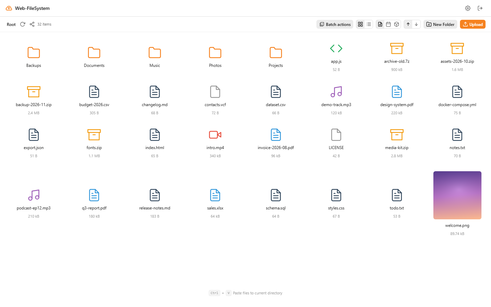
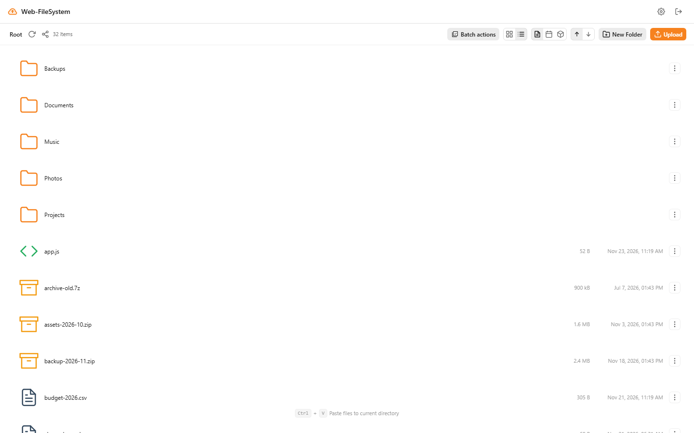
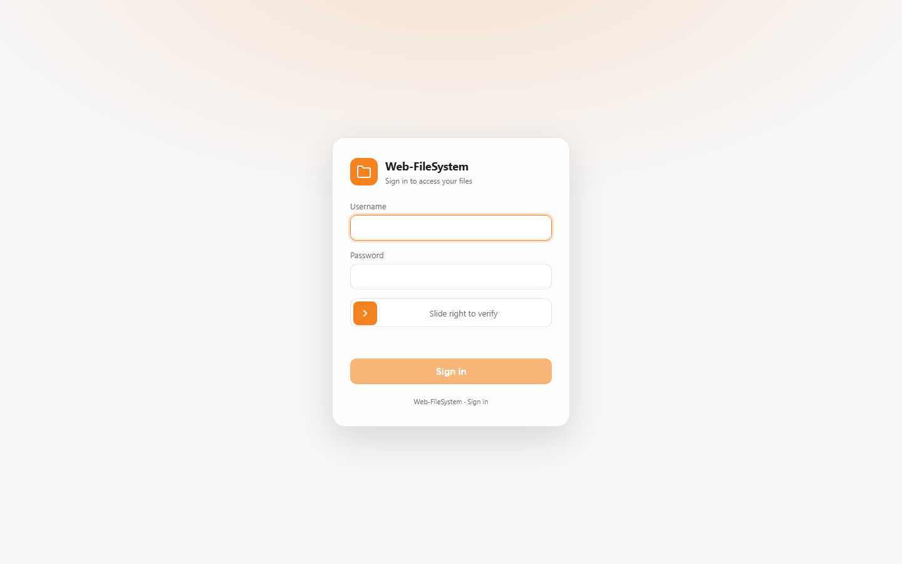

# Web-FileSystem

📁 A local-first web file manager that runs entirely on your own machine. A zero-dependency Node.js server uses a folder on disk as storage — no cloud account, no external service.

**[中文](./README-CN.md) | English** · [Changelog](./CHANGELOG.md)

[](https://github.com/dowhere/Web-FileSystem/releases)

**Contents:** [Features](#features) · [Screenshots](#screenshots) · [Quick Start](#quick-start) · [Docker](#docker-deployment) · [Configuration](#configuration) · [Data and Storage](#data-and-storage) · [FAQ](#faq)

## Features

| Capability               | Details                                                                                                            |
| ------------------------ | ------------------------------------------------------------------------------------------------------------------ |
| **Local file service**   | A zero-dependency Node.js server uses a folder on your machine as the bucket; no cloud account or external service |
| **Accounts & auth**      | Sign-in page with slider verification and 7-day sessions; multiple users, admin/member roles, password changes     |
| **Full file management** | Directory browsing, name/date/size sorting, previews, rename, copy, move, recursive delete, batch operations       |
| **Upload experience**    | Drag/paste upload, concurrency, automatic multipart, pause/resume, cleanup of unfinished parts                     |
| **Filename templates**   | `[name]`, `[ext]`, `[hash:N]`, date, timestamp, UUID, and directory templates                                      |
| **Image compression**    | Local WebAssembly compression for JPEG, PNG, WebP, and AVIF; optional Tinify relayed through your own local server |
| **Preview & share**      | Image, video, audio, and text previews; direct URLs, QR codes, Markdown, HTML; login-free read-only share links    |
| **Cross-platform UX**    | PWA, light/dark themes, zh / zh_TW / en / ja localization                                                          |

## Screenshots



| List view | Image preview |
| --- | --- |
|  |  |

| Account settings | Read-only share |
| --- | --- |
|  |  |

| Sign-in | Sessions & roles |
| --- | --- |
|  | Password plus a slider gesture, 7-day sessions, admin/member roles. |

## Quick Start

**Requirements:** Node.js 18+. There are no third-party runtime dependencies, so there is nothing to install.

```bash
git clone https://github.com/dowhere/Web-FileSystem.git
cd Web-FileSystem
npm run dev
# open http://127.0.0.1:5500
```

On the first start, the server generates a random login password and prints it once:

```text
  Web-FileSystem (local mode)
  ➜  http://127.0.0.1:5500
  ➜  data: /path/to/web-filesystem/data
  ➜  bucket: local
  ➜  auth: user "admin" / password "xxxxxxxxxxxx" (generated, shown only once)
```

Save that password. Its hash is stored in `data/.web-filesystem/auth.json` and reused on later starts.

To access the app from other devices on your LAN, bind to all interfaces:

```bash
npm run dev -- --host 0.0.0.0
```

### Configure the login account

```bash
# Set username and password (persisted to auth.json for future starts)
npm run dev -- --auth-user admin --auth-password 'your-password'

# Disable authentication (only recommended for loopback/local use)
npm run dev -- --no-auth
```

Environment variables are also supported: `AUTH_USER`, `AUTH_PASSWORD`, `NO_AUTH=1`, `TRUST_PROXY=1`.

Prefer containers? See [Docker Deployment](#docker-deployment) below.

## Docker Deployment

The image only contains `package.json`, `server.js`, and `src/`. No `npm install` is needed, and the host does not need Node.js.

### Requirements

- Docker Engine 20.10+ with Compose v2 (`docker compose`)
- About 100 MB for the image, plus the space used by your files

### Quick start

```bash
cd docker
cp .env.example .env          # optional: adjust port, account, password
docker compose up -d --build
```

Open `http://localhost:5500`.

The container always listens on `0.0.0.0:5500`. The host binding is controlled by `WF_BIND` (default `0.0.0.0`, so the app is reachable from your LAN; set `WF_BIND=127.0.0.1` to restrict it to this machine).

### Environment variables

| Variable        | Default   | Description                                                                        |
| --------------- | --------- | ---------------------------------------------------------------------------------- |
| `WF_BIND`       | `0.0.0.0` | Host address to publish the port on; use `127.0.0.1` behind a reverse proxy        |
| `WF_PORT`       | `5500`    | Host port                                                                          |
| `AUTH_USER`     | `admin`   | Administrator username                                                             |
| `AUTH_PASSWORD` | empty     | When set, this password is enforced on every start                                 |
| `BUCKET`        | `local`   | Local bucket (folder) name                                                         |
| `NO_AUTH`       | `0`       | Set to `1` to disable login entirely (trusted networks only)                       |
| `TRUST_PROXY`   | `0`       | Set to `1` to trust `X-Forwarded-For` for login rate limiting (trusted proxy only) |

`PORT`, `HOST`, and `DATA_DIR` are fixed inside the compose file (`5500`, `0.0.0.0`, `/data`). Change `WF_PORT` to publish a different host port.

### First start and the login password

- If `AUTH_PASSWORD` is set in `.env`, that password is used (and re-applied on every start).
- If it is empty, the first start generates a random password and prints it once:

  ```bash
  docker compose logs app | grep generated
  ```

  Sign in as `admin` and change the password under **Settings → Account**.

### Common commands

```bash
docker compose logs -f app                 # follow logs
docker compose ps                          # status + health check
docker compose restart app                 # restart
docker compose down                        # stop (keeps the data volume)
docker compose down -v                     # stop and DELETE all data
git pull && docker compose up -d --build   # upgrade after pulling new code
```

The image defines a TCP health check; `docker compose ps` shows `healthy` once the server accepts connections.

### Data, backup, and restore

Files, users, and the share-link signing key live in the `web-filesystem-data` named volume (mounted at `/data`). The volume survives `docker compose down` and image rebuilds.

```bash
# Inspect the volume
docker volume inspect web-filesystem-data

# Back up to the current directory (run from docker/)
docker run --rm -v web-filesystem-data:/data -v "$PWD":/backup alpine \
  tar czf /backup/web-filesystem-data.tar.gz -C /data .

# Restore (overwrites files with the same names)
docker run --rm -v web-filesystem-data:/data -v "$PWD":/backup alpine \
  tar xzf /backup/web-filesystem-data.tar.gz -C /data
```

### Use a host directory instead of a volume

To manage the same files directly on the host, replace the volume mount in `docker/docker-compose.yml`:

```yaml
    volumes:
      - ../data:/data
```

Make sure the container user can write to it (the image runs as UID/GID `1000:1000`):

```bash
sudo chown -R 1000:1000 ../data
```

You can then remove the trailing `volumes:` block (the named volume) from the compose file.

### Reverse proxy and HTTPS

For access from other networks, keep the app behind an HTTPS reverse proxy:

1. Set `WF_BIND=127.0.0.1` in `docker/.env` and recreate the container.
2. Set `TRUST_PROXY=1` so login rate limiting sees real client addresses.
3. Allow large uploads in the proxy — a file manager may receive very large request bodies.

nginx:

```nginx
server {
    listen 443 ssl;
    server_name files.example.com;

    client_max_body_size 0;          # no request-body limit for uploads
    proxy_request_buffering off;     # stream uploads instead of spooling them

    location / {
        proxy_pass http://127.0.0.1:5500;
        proxy_set_header Host $host;
        proxy_set_header X-Forwarded-For $proxy_add_x_forwarded_for;
        proxy_set_header X-Forwarded-Proto $scheme;
    }
}
```

Caddy:

```caddy
files.example.com {
    reverse_proxy 127.0.0.1:5500
}
```

### Build and run without Compose

```bash
# from the repository root
docker build -f docker/Dockerfile -t web-filesystem .

docker run -d --name web-filesystem \
  -p 5500:5500 \
  -v web-filesystem-data:/data \
  -e AUTH_USER=admin \
  -e AUTH_PASSWORD='change-me' \
  --security-opt no-new-privileges:true \
  --restart unless-stopped \
  web-filesystem
```

### Security notes

- The container runs as the unprivileged `node` user (UID/GID 1000) and enables `no-new-privileges`.
- Only `/data` is mounted; the rest of the container filesystem is not used for storage.
- The login password travels over plain HTTP unless the server is behind HTTPS. Never combine `NO_AUTH=1` with a non-loopback address.
- Pulling `node:24-alpine` requires access to Docker Hub; for air-gapped hosts, import the base image first.

See [docker/README.md](./docker/README.md) for additional details.

## Configuration

### CLI options

| Option            | Environment     | Default     | Description                                                                            |
| ----------------- | --------------- | ----------- | -------------------------------------------------------------------------------------- |
| `--port`          | `PORT`          | `5500`      | Listening port                                                                         |
| `--host`          | `HOST`          | `127.0.0.1` | Listening address; use `0.0.0.0` for LAN access                                        |
| `--data`          | `DATA_DIR`      | `./data`    | Data directory                                                                         |
| `--bucket`        | `BUCKET`        | `local`     | Local bucket name                                                                      |
| `--auth-user`     | `AUTH_USER`     | `admin`     | Login username                                                                         |
| `--auth-password` | `AUTH_PASSWORD` | generated   | Login password                                                                         |
| `--no-auth`       | `NO_AUTH=1`     | —           | Disable login entirely                                                                 |
| `--trust-proxy`   | `TRUST_PROXY=1` | —           | Trust `X-Forwarded-For` for login rate limiting (only behind a trusted reverse proxy) |

### User management

- The first start creates an administrator account (username `admin` by default). Use **Settings → Account** to change your own password.
- Administrators can also add users, assign the admin/member role, reset other users' passwords, and delete users. Members can only change their own password.
- New passwords must be at least 8 characters. Resetting a password or deleting an account invalidates that user's existing sessions; changing your own password keeps the current session and signs out your other sessions.
- Accounts and password hashes live in `data/.web-filesystem/auth.json`. A legacy single-user record is migrated automatically to an administrator account and keeps its password.
- Passing `--auth-password` at startup sets the password for the target account (`--auth-user`, or the existing administrator when omitted), ensures it is an administrator, and leaves other users untouched.

### Login verification

The sign-in page requires a rightward slider gesture in addition to the password. The server issues a one-time challenge (5-minute expiry and a minimum delay), and `/api/login` only accepts a verified challenge. A failed verification or failed sign-in requires a new gesture. This raises the cost of simple automation; it is **not** a cryptographic second factor such as TOTP. The existing per-IP login rate limit still applies.

Challenges are rate-limited per IP (30 per 5 minutes) on top of the 10-attempt login limit. When the server sits behind a reverse proxy, start it with `--trust-proxy` (or `TRUST_PROXY=1`) so both limits see the real client address instead of the proxy's. Only enable this when the proxy overwrites `X-Forwarded-For`.

## Data and Storage

### Data layout

```text
data/
├── local/                     # bucket contents (the actual files)
├── .web-filesystem/
│   ├── meta.json              # Content-Type metadata
│   ├── auth.json              # users, roles, and password hashes (v2)
│   ├── share-secret           # signing key for share links (keep private)
│   └── tmp/                   # staged upload bodies (cleared on startup)
└── .uploads/                  # temporary multipart parts (cleared on startup)
```

### Storage behaviour

- Uploads are written to `data/.web-filesystem/tmp/` first and moved into place with an atomic rename, so a half-finished file is never listed or downloadable.
- Static assets and objects are served with an `ETag`; reloads and repeated previews revalidate and normally cost only a `304`.
- Deleting a folder removes the whole directory tree in one request.
- Object keys containing `\`, `.`/`..` segments, or symlinks that resolve outside the bucket are rejected.

> [!WARNING]
> `--host 0.0.0.0` exposes the server to your LAN. The login password travels over plain HTTP, so use this only on trusted networks; put the server behind an HTTPS reverse proxy for remote access. Never combine `--no-auth` with a non-loopback address.

## Common Configuration

### Filename templates

- `[name]_[hash:6].[ext]` — original name plus content hash
- `images/[date:YYYY/MM/DD]/[uuid].[ext]` — date-based directories
- `backup/[timestamp]-[name].[ext]` — timestamped backups

### Read-only share links

When serving the app with the bundled file service (`npm run dev` or Docker), you can create **login-free, read-only share links** for files and directories. The links are signed by the server and keep working even when the recipient is not signed in.

- Choose **Share link** from a file or folder context menu; folders also have a toolbar button.
- Pick an expiry: 1 day, 7 days, 30 days, 1 year, or never. Expired links are rejected by the server.
- The signature covers the bucket, path, and expiry. Changing any of them invalidates the link. Recipients need no account or session.
- A link can only list, preview, and download content inside its scope. It cannot upload, modify, or delete anything.
- A directory share is rooted at the directory chosen when the link was created and includes every descendant, including files added while the link is valid. Avoid sharing parent folders that contain sensitive content.

The signing key is stored in `data/.web-filesystem/share-secret`. Deleting or rotating that file immediately invalidates **all** existing share links (a new key is generated on restart). There is currently no UI to revoke an individual link; to invalidate one early, delete the shared file/folder, wait for expiry, or rotate the key.

> [!CAUTION]
> A share link is itself a bearer credential: anyone who has it can read the shared content. Send links only through trusted channels, and serve the app over HTTPS when it is reachable from the internet.

## Local Development

```bash
# Local file mode (recommended, includes login authentication)
npm run dev
```

No build is required. Core browser dependencies (`dayjs`, `filesize`) are vendored in `src/vendor/`, so the app starts offline; image compression and QR code modules are loaded on demand. The app **must** be served by `server.js` — there is no static-only mode. See [AGENTS.md](./AGENTS.md) for development conventions.

Type checking:

```bash
npm run typecheck
```

## FAQ

**I forgot the login password.** If another administrator can sign in, reset it under **Settings → Account → User management**. Otherwise pass `--auth-password` to set a new password for the target account (omit `--auth-user` to reset the existing administrator); other users are preserved. Deleting `data/.web-filesystem/auth.json` removes all users and generates a new administrator password. In Docker, run the command inside the container or set `AUTH_PASSWORD` in `.env` and restart.

**How long does the login last?** The session cookie is valid for 7 days. Sessions live in server memory, so restarting the server requires signing in again. Resetting a password or deleting an account invalidates its sessions immediately.

**Do share links require a login? What can recipients do?** No. The link carries its own read-only signature, so recipients can browse, preview, and download but cannot write or delete. Links stop working at their configured expiry, and directory links include everything under the shared directory.

**Is Tinify compression safe?** The Tinify key stays in your browser and is sent only to your own local server, which relays the image to `api.tinify.com` and streams the result back (the Tinify API sends no CORS headers, so a browser cannot call it directly). No third-party proxy is involved, and the key is never written to disk.

**Which browsers are supported?** The latest Chrome, Edge, Firefox, and Safari. Internet Explorer is not supported.

**Why is my upload failing?** Make sure the data directory (including `.web-filesystem/tmp`) is writable and has enough free space, and that the server process is still running. Multipart uploads require `POST` / `PUT` / `DELETE` on `/s3`; files must not exceed 1 TiB.

**Can I host the frontend as a static site?** No. The app needs the bundled server for storage, authentication, and share links; there is no static-only mode.

## License

MIT License

This project is based on [R2 Web](https://github.com/vikiboss/r2-web) by [Viki](https://github.com/vikiboss) (MIT License), rebranded and extended as Web-FileSystem. Thanks to the original author.
